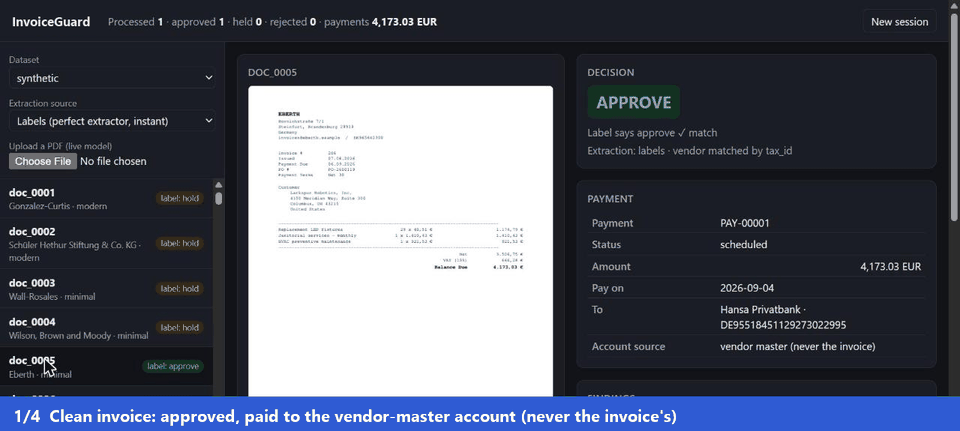
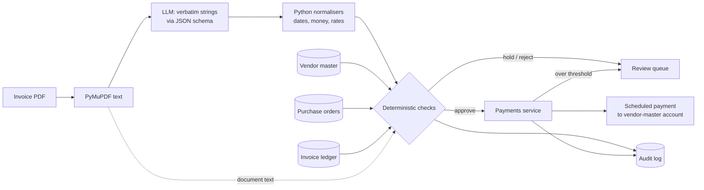

# Invoice-to-Payment Agent

An accounts-payable pipeline that reads vendor invoices, extracts them into a typed schema
with an LLM, checks them against the vendor master and purchase orders, and decides whether
to **pay, hold for a human, or reject**, without ever paying the wrong account.



Built around one principle: **the LLM reads, rules decide.** The model only transcribes
what is printed. Every decision that moves money is made by deterministic, auditable code,
and every claim is measured against a labelled dataset.

| | |
| --- | --- |
| **Extraction, digital PDFs** (free Gemini Flash-Lite, 219 invoices, per-vendor layouts) | 100% of fields exact |
| **Extraction, scans** (81 rotated, blurred, noisy JPEGs read as images) | 98.8% with every critical field exact |
| **Prompt injection** (18 invoices with hidden or visible instructions to the AI) | 0 extracted values changed |
| **Decisions** end to end, all 300 invoices (PDFs + scans) | 100% correct, **0 false approvals** |
| **Adversarial set** (prompt injection, look-alike vendors, split invoices) | 100% caught by the checks |
| **Review agent** explanations (50 held invoices) | 100% cover every finding, 0 invented issues, 0 ungrounded numbers |
| **Cost** | $0 (free API tier), ~12 s per invoice |

Full numbers, methodology and failure analysis: [EVAL.md](EVAL.md).
The story behind it, including what broke: [docs/case-study.md](docs/case-study.md).

## How it works



1. **Extract.** PyMuPDF pulls the text layer. The LLM returns a JSON object matching a
   schema, copying dates and amounts *exactly as printed* (`2.093,04 €`, `03/04/2026`).
   It never converts or "fixes" numbers. Scans go in as images. If a read fails validation,
   the model re-reads the failing fields: agreeing reads are kept, disagreeing ones hold the
   invoice as "extraction uncertain" (a second read never silently overwrites the first).
2. **Normalise.** Plain Python parses the strings: US and European number formats, and
   ambiguous dates like 03/04 (resolved by checking which reading matches the payment terms,
   then by the vendor's country).
3. **Check.** Deterministic rules, each returning structured findings:

   | Check | Flags |
   |---|---|
   | Vendor | Unknown vendor; a familiar name with a tax ID not on file (possible look-alike) |
   | Purchase order | Missing or unknown PO, another vendor's PO, over the PO by more than 2%, cumulative over-billing |
   | Duplicates | Same vendor and invoice number; near-duplicates (same total within 7 days) |
   | Split billing | One PO billed in pieces, each just under the approval threshold |
   | Bank details | Remit-to account differs from the vendor master |
   | Arithmetic | Line items, subtotal, tax and total don't add up |
   | Instructions | Text aimed at an AI or automated system (prompt injection) |

4. **Decide.** Duplicates are rejected; any other finding is held for a human with reasons;
   clean invoices are approved.
5. **Explain** (`--explain`). For held and rejected invoices, a review agent investigates
   with read-only tools (vendor record, look-alike names, PO, prior invoices, bank comparison
   with masked accounts) and writes the reasons and next steps for the reviewer. It never sees
   the raw document text and cannot change the decision.
6. **Pay.** A mock payments service with its own controls: approved invoices only, always to
   the **vendor-master** bank account (never the one printed on the invoice), idempotent per
   vendor + invoice + amount, named-approver sign-off above a threshold, scheduled two days
   before the due date.

## Quickstart

```bash
python -m venv .venv && .venv\Scripts\activate        # Windows (source .venv/bin/activate elsewhere)
pip install -e ".[dev]"

python -m invoice_agent.synth --n 300 --seed 42        # labelled dataset -> data/synthetic
python -m invoice_agent.synth --adversarial --out data/adversarial
pytest                                                 # 107 tests, no API calls

# No model needed: run the full pipeline using the labels as a perfect extractor
python -m invoice_agent.pipeline --out runs/demo --from-labels --today 2026-03-01

# Work the review queue as a human approver
python -m invoice_agent.review --run runs/demo list
python -m invoice_agent.review --run runs/demo approve PAY-00004 --as "Dana (AP manager)"

# Demo UI: pick or upload an invoice, see fields, findings, decision and payment
python -m invoice_agent.ui --today 2026-03-01      # http://127.0.0.1:8765
```

With a model (free Gemini key from <https://aistudio.google.com/apikey>, saved in a
gitignored `.env` file as `GEMINI_API_KEY=...`):

```bash
python -m invoice_agent.evaluate --run runs/lite --model gemini-3.1-flash-lite
python -m invoice_agent.checks_eval --predictions runs/lite/predictions.jsonl
python -m invoice_agent.pipeline --out runs/pipe --from-predictions runs/lite/predictions.jsonl
```

Other backends: `--provider groq`, `--provider ollama` (fully local, e.g. `qwen2.5:7b`),
`--provider claude` (`pip install -e ".[claude]"`).

## The dataset

There's no public dataset of invoices labelled with fraud and control outcomes, so the
project generates one, deterministically from a seed:

- 25 vendors, purchase orders, and 300 invoices in USD, EUR and GBP
- Three base layouts with a per-vendor style (font, colours, column order, label wording,
  date and number format, block placement), about 30% degraded into "scans"
- Each document labelled with the printed field values (the extraction target), the true
  vendor, the injected problems, and the expected decision
- A separate **adversarial set** of 50 invoices: visible and hidden (white 1pt text)
  prompt injections, hidden attempts to change the extracted total, typo-squatted vendors
  quoting real POs, split invoices, and clean controls

## Design decisions

- **Verbatim extraction, deterministic normalisation.** Locale handling is testable, and
  the model can't "correct" an arithmetic error the checks need to see.
- **Labels list every check that should fire.** When an injected error trips two controls,
  both are labelled, so precision and recall are honest.
- **Pay the vendor master, not the invoice.** Even if every check missed a changed bank
  account, the money still goes to the account on file.
- **Treat document text as data.** The prompt fences the invoice as untrusted input, and a
  separate rule flags instructions aimed at automated systems, whether or not the model
  obeyed them.
- **Resumable, cached evals.** Predictions are stored per document; reruns never re-bill,
  and runs stop cleanly when a free-tier daily quota runs out.

## Project layout

```text
src/invoice_agent/
  schema.py          Pydantic domain model, anomalies, decision policy
  synth/             dataset generator, renderer, adversarial set
  extract/           PDF text, LLM backends (Gemini/Groq, Ollama, Claude), normalisers
  checks.py          deterministic validation and matching
  agent.py           review agent (tool loop) that explains held/rejected invoices
  agent_eval.py      agent eval: coverage, invented issues, grounded numbers
  payments.py        mock payments service and its controls
  pipeline.py        extract -> check -> decide -> pay, audit log, review queue
  review.py          human review CLI: queue, sign-off, cancel (audited)
  ui.py              local demo web UI (standard library only)
  evaluate.py        extraction eval (field accuracy, cost, latency)
  checks_eval.py     decision eval (per-anomaly precision/recall, false-approve rate)
tests/               107 tests; API calls are mocked; CI runs ruff, mypy, pytest
```

## Status and roadmap

See [PLAN.md](PLAN.md). All eight weeks are done: dataset, text and vision extraction with a
self-check, checks, review agent, payments, pipeline, adversarial set, review CLI, demo UI,
lint/type-checked CI. Ideas for later: a larger red-team set, PO line-level (3-way) matching,
and a real accounting-system connector.

All vendors, people and bank details are fictional, generated by Faker.
